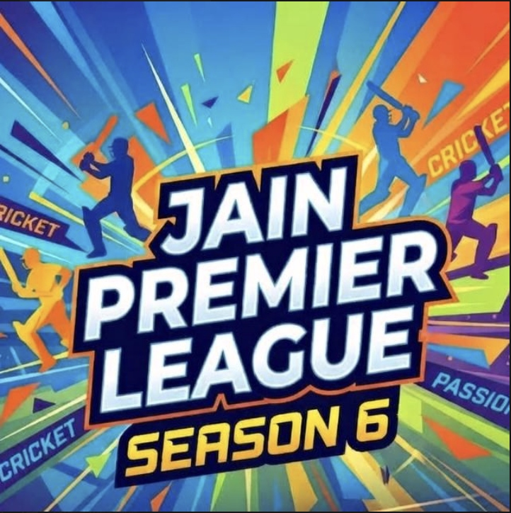

# 🏏 JPL Season 6 - Cricket Auction Pool & Player Management System

A high-performance, interactive Cricket Auction and Player Management web application built for **Jain Premier League (JPL) Season 6**.



---

## ✨ Features

- **🎯 Real-Time Live Auction Console**:
  - Live bidding console with base price and custom bid increments.
  - SOLD / UNSOLD bidding controls with instant team allocation.
  - Interactive lot navigation and quick lot number search.

- **👥 Complete 66-Player Pool**:
  - Pre-loaded with 66 player profiles (Lot #1 to Lot #66).
  - Search by player name, lot number, category, or role.
  - Detailed player statistics: Batting style, bowling style, category, past performance, and base price.
  - Editable player names directly inside player profiles with instant live sync.

- **📸 Zero-Loss Photo & Profile Storage**:
  - Offline-first persistent photo storage using browser IndexedDB (`JPL_Photos_DB_v4`).
  - Safe re-upload and custom photo support for every player.
  - **Full JSON Backup & Restore**: One-click export/import including all 66 player stats, teams, and embedded high-resolution photos.

- **🛡️ Team Management**:
  - Dynamic squad roster and remaining purse tracker.
  - Customizable team names and team logos.
  - Instant team transfer and squad breakdown modal.

- **⚡ High-Performance Architecture**:
  - Ultra-fast Vanilla JavaScript and responsive CSS with hardware acceleration.
  - Zero lag, smooth modal transitions, and instant action bar responsiveness.

---

## 🚀 Getting Started

### Local Setup
Simply clone or download this repository and run a local web server:

```bash
# Clone the repository
git clone https://github.com/Ritikjain1407/JPL-AUCTION-LIST.git
cd JPL-AUCTION-LIST

# Run with Python (built-in)
python -m http.server 3000
```

Open your browser and navigate to:
```
http://localhost:3000
```

### GitHub Pages (Online Access)
You can host this application completely free using **GitHub Pages**:
1. Go to repository **Settings** > **Pages**.
2. Under **Build and deployment**, select `Deploy from a branch`.
3. Choose branch: `main` and folder: `/ (root)`.
4. Click **Save**. Your app will be live at:
   `https://ritikjain1407.github.io/JPL-AUCTION-LIST/`

---

## 📁 Project Structure

```
JPL-AUCTION-LIST/
├── index.html            # Main UI, auction console, roster table, modals
├── styles.css            # Modern sports aesthetic styling & animations
├── app.js                # Auction logic, IndexedDB photo store, backup/restore
├── players_data.js       # Core 66-player database and default team rosters
├── jpl_banner.jpg        # Header branding image
├── cricket_bg.jpg        # Stadium background texture
├── dark_cricket_stadium.jpg # High-contrast auction backdrop
└── README.md             # Project documentation
```

---

© 2026 Jain Premier League (JPL). All rights reserved.
